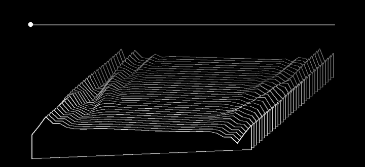

# TOPO

A wavetable synth for the Teenage Engineering OP-XY. Load a WAV from your user samples, hold a note and turn **Position** to move through its waveforms. Each ridge on the instrument page is one cycle. The white ridge follows your scan, and **Warp** bends the shape you hear.

*Vowel-256, with Warp and Drift at zero. The animation illustrates the position sweep. The audio example plays the same bank at C4 through TOPO’s oscillator.* [Listen to the dry sweep (WAV)](docs/Topo-scan.wav) · [View the full M1 layout](docs/M1-preview.png)

## Install

TOPO 0.1.0 targets **OP-XY OS 1.2.1** and **Open-XY SDK API 1.17**. TE Builder 0.5.8 build 30 was used for release checks.

1. In TE Builder, choose **File → Import Git Repository…** and paste `https://github.com/erhenius/OP-XY-TOPO.git`. For an offline source import, choose **File → Import Machine or Extension ZIP…** and open [TOPO-0.1.0.zip](release/TOPO-0.1.0.zip).
2. In **Available**, select **TOPO 0.1.0**, queue the change, and build and stage for the intended XY. If you already use **User Wavetable**, select the new version on its existing row. Both names use machine ID `userwt`.
3. On an instrument track, select **userwt** in the XY’s stock machine picker and load the default preset. The picker displays the internal ID. Hold a note and sweep K2. **Glass** moves from a sine toward a third harmonic. The **Reed** preset brings in a second harmonic instead.

## Controls

| M1 encoder | What you hear |
| --- | --- |
| **K1 · Cycle** | Sets samples per waveform to 256, 512, 1024 or 2048. Match this to your file. Glass and Reed use 2048. |
| **K2 · Position** | Crossfades continuously between adjacent waveforms. Fully left plays the first cycle, fully right the last. |
| **K3 · Warp** | Bends the oscillator’s read phase within each cycle. Fully left gives the original shape. |
| **K4 · Drift** | Adds slow pitch drift. Fully left holds pitch steady. |

## Load your own tables

Copy a WAV into the XY’s **user samples** folder. A `wavetables` subfolder is fine. Set K1, open the track’s sample browser and highlight the file. With sample preview enabled, a compatible file auditions its first cycle at C4 for half a second. Confirm to load the entire bank. Keep the file in place when saving and reopening a project.

For a first custom bank, copy [Vowel-256.wav](examples/Vowel-256.wav) to user samples and set **K1 to 256**. Its 32 cycles sweep two formants in opposite directions. New tables can be added after installation.

| WAV detail | Supported use |
| --- | --- |
| Tested format | 44.1 kHz, signed 16-bit PCM. Mono or stereo. Stereo uses the left channel. |
| Layout | Concatenate complete single cycles of equal width, without silence or padding between them. |
| Length | The active sample region must divide evenly by the K1 width. A single-cycle WAV works and sounds the same across K2. |
| Display | One ridge per cycle up to 32. For larger banks, the screen shows 32 representative cycles including both ends. Audio scans the whole bank. |

If the screen says **Check cycle length**, check the trim and K1. A wrong width can still divide evenly and change the tone. For bright tables at high pitches, try less Warp or a bank with fewer upper harmonics.

## Build and contribute

The root manifest, machine source and all three SDK integration patches are included. The source guide covers a standalone firmware build, host tests and regenerating the release ZIP. [Build from source](docs/BUILDING.md) · [Contributing](CONTRIBUTING.md) · [Release notes](CHANGELOG.md)

TOPO’s original code and documentation use **GPL-3.0-only**. Glass and Reed retain their CC0 dedication. The Open-XY MIT notice accompanies upstream material in the integration patches. [License](LICENSE) · [Component notices](LICENSES/README.md)
